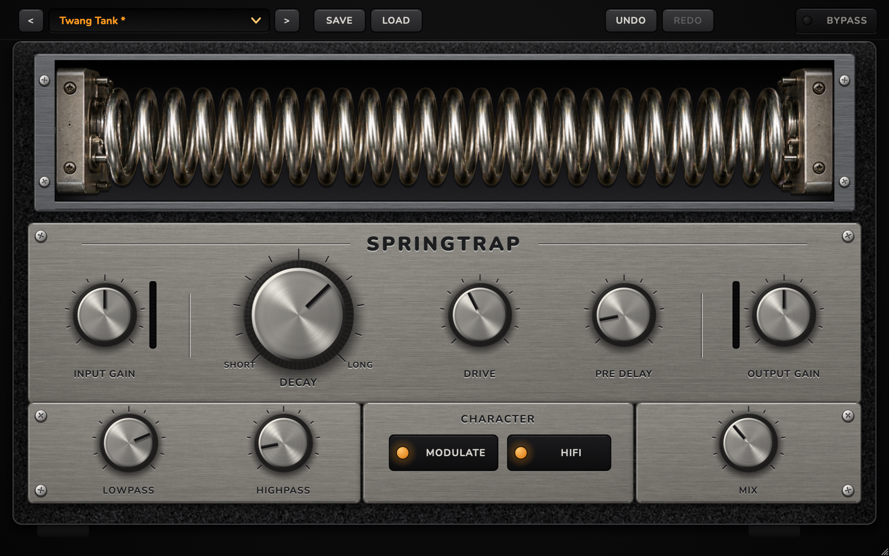
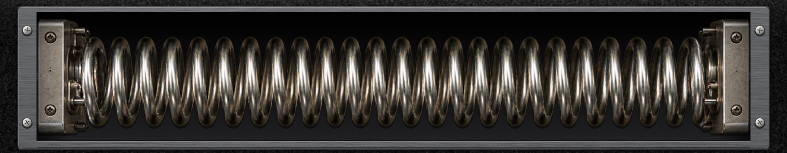
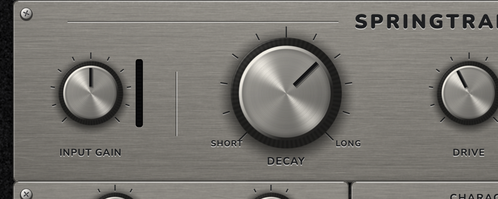

# SPRINGTRAP

**A spring-tank reverb with a drive stage, by VVO Audio.** Free. VST3 for macOS and Windows.

**[⬇ Download the latest version](https://github.com/vvoaudio/springtrap-releases/releases/latest)**

| | macOS | Windows |
|---|---|---|
| File | `SPRINGTRAP-<version>-macOS-Universal.pkg` | `SPRINGTRAP-<version>-Windows-Setup.exe` |
| Needs | macOS 11 Big Sur or later | Windows 10 or later · 64-bit |
| Macs | Apple Silicon (M1 and later) or Intel | — |
| Format | VST3 | VST3 |
| Installs to | `/Library/Audio/Plug-Ins/VST3/` | `C:\Program Files\Common Files\VST3\` |

## Install on Mac
1. Download the `.pkg` from the [latest release](https://github.com/vvoaudio/springtrap-releases/releases/latest) and double-click it.
2. macOS will say it can't verify the developer (SPRINGTRAP is free and not registered with Apple). Click **Done**, then open **System Settings → Privacy & Security**, scroll down and click **Open Anyway** next to the SPRINGTRAP message. Confirm with your password.
3. Click through the installer (it asks for your administrator password).
4. Restart your DAW or rescan plug-ins, and load **SPRINGTRAP** from your VST3 plug-ins.

## Install on Windows
1. Download the `.exe` from the [latest release](https://github.com/vvoaudio/springtrap-releases/releases/latest) and run it.
2. If Windows shows **"Windows protected your PC"**, click **More info → Run anyway** (SPRINGTRAP is free and not code-signed).
3. Click through the installer (it asks for administrator permission).
4. Restart your DAW or rescan plug-ins, and load **SPRINGTRAP** from your VST3 plug-ins.

## Updating
Quit your DAW, then run the new installer the same way. It replaces the old version (including any older copy in your own plug-in folder) and keeps your presets and projects.

### Update notice
Once a day SPRINGTRAP asks GitHub which version is the latest (one request to `api.github.com`; nothing else is sent). If a newer one exists, an **UPDATE AVAILABLE!** button appears in the top bar. Click it: the installer for your system is downloaded, checked against the published SHA-256 checksum and opened. Quit your DAW and finish the installer. Nothing is installed without you.
To turn the check off, right-click the button and choose **Turn off update checks** (or create an empty file named `update-checks-off` in `~/Library/Application Support/SPRINGTRAP/` on Mac, `%APPDATA%\SPRINGTRAP\` on Windows). Delete that file to turn it back on.

## Quick guide
- **Decay** — how long the spring keeps ringing, from short to long.
- **Drive** — grit: pushes the spring signal into an amp stage (reverb only, your dry signal stays clean).
- **Pre Delay** — the wait before the spring starts (0–80 ms).
- **Input Gain / Output Gain** — level into the spring and level out (±18 dB). The sound reacts to the input level, like real hardware.
- **Lowpass / Highpass** — cut highs or lows of the spring only.
- **Modulate** — a slow wobble that makes the spring sound alive. **HiFi** — a brighter, cleaner spring tone.
- **Mix** — dry/wet balance.
- **Presets, Save, Load, Undo, Redo, Bypass** — in the top bar. Hover or turn any knob to read its exact value; double-click resets it, Shift gives fine control.

## Uninstall
- **Mac:** delete `/Library/Audio/Plug-Ins/VST3/SPRINGTRAP.vst3`.
- **Windows:** Settings → Apps → **SPRINGTRAP (VST3)** → Uninstall.

Presets live in `~/Library/Application Support/SPRINGTRAP/Presets` (Mac) or `%APPDATA%\SPRINGTRAP\Presets` (Windows).

---
SPRINGTRAP is free for personal use and provided as is, without warranty. VST is a trademark of Steinberg Media Technologies GmbH.
The interface font is Nunito (SIL Open Font License).
