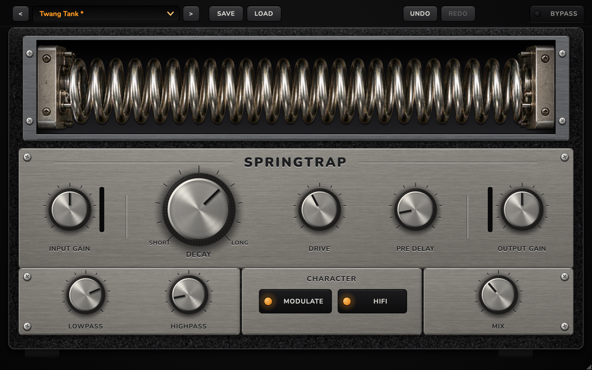

# SPRINGTRAP 0.1

First public version. A spring-tank reverb with a drive stage, by VVO Audio. Free, VST3, macOS and Windows.

**What it does**
- **Decay, Pre Delay, Drive:** the spring's length, the wait before it starts, and grit from an amp stage on the reverb only.
- **Input / Output Gain, Lowpass, Highpass, Mix:** level in and out, tone of the spring only, dry/wet.
- **Modulate and HiFi:** a slow living wobble, and a brighter cleaner tone.
- 12 factory presets, Save / Load, Undo / Redo, click-free Bypass, resizable window.
- **Update notice:** a button appears when a newer version is published.

**Install**
- **Mac:** download `SPRINGTRAP-0.1.0-macOS-Universal.pkg` (macOS 11 or later, Apple Silicon and Intel). Not notarised: after opening it once, allow it in System Settings → Privacy & Security → Open Anyway.
- **Windows:** download `SPRINGTRAP-0.1.0-Windows-Setup.exe` (Windows 10 or later, 64-bit). Not signed: More info → Run anyway.

Restart your DAW or rescan plug-ins, then load SPRINGTRAP. Checksums are in `SHA256SUMS.txt`.
